# EverDrive N8 (EDFC) - Tradução Completa em Português do Brasil (PT-BR)

[](https://github.com/thiagocarvalhodemello/nes-everdrive/releases)
[](LICENSE)

Tradução completa para Português do Brasil (PT-BR) do Sistema Operacional do flashcart **EverDrive N8 / Famicom** (por Igor Golubovskiy / Krikzz), para placas clone baseadas em Altera Cyclone II e MAX II CPLD (revisão `V3.1 2024.07`), com **9 temas com banner**, **menu do jogo com capa** e troca de tema por um botão.

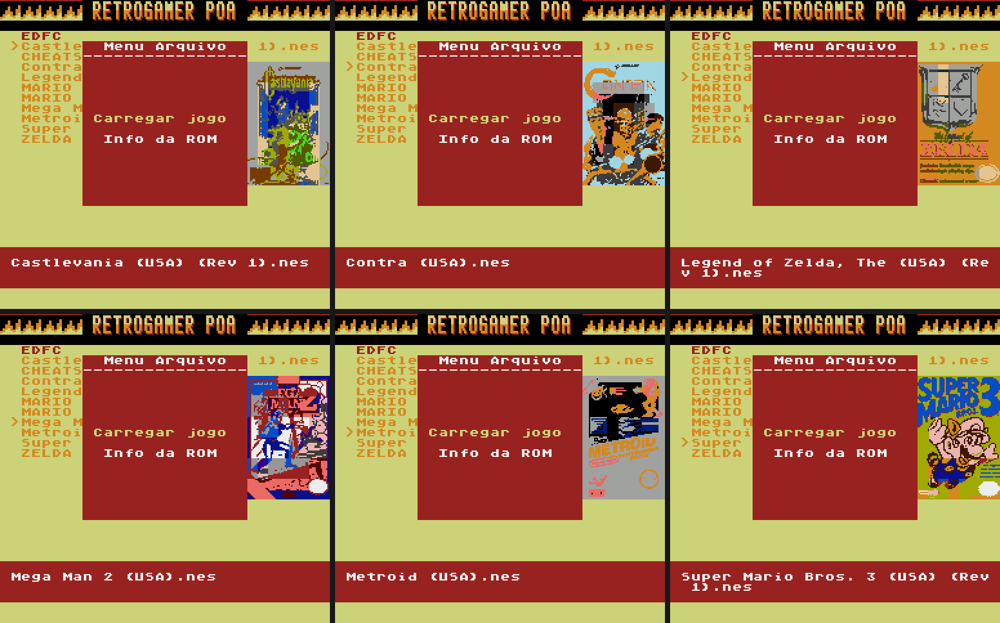

---

## 🎮 Downloads (Releases)

Na aba [**Releases**](https://github.com/thiagocarvalhodemello/nes-everdrive/releases) (versão atual: **v1.5**) há dois arquivos. Escolha **um** e extraia na **raiz** do cartão MicroSD (FAT16/FAT32):

| Arquivo | Conteúdo |
| :--- | :--- |
| `EDFC-N8-PTBR-v1.5-com-capas.zip` | Sistema completo **+ 2.504 capas** (`EDFC/ARTS/`). |
| `EDFC-N8-PTBR-v1.5.zip` | Sistema completo, sem capas. |

As capas são identificadas pelo **conteúdo** da ROM (não pelo nome do arquivo), então funcionam com dumps padrão No-Intro/GoodNES. A versão para **hardware original Krikzz (base v1.26)** continua na [release v1.3](https://github.com/thiagocarvalhodemello/nes-everdrive/releases/tag/v1.3-ptbr).

---

## 🕹️ Controles no Navegador de Arquivos

| Botão | Ação |
| :--- | :--- |
| **A / B** (confirmar) | Abre a pasta, ou o **menu do jogo**: capa + `Carregar jogo` + `Info da ROM` |
| **SELECT** | Próximo tema (9 temas, em ciclo); o tema fica salvo e volta no próximo boot |
| **START** | **Menu Principal**: Opções, Trapaças, Info Sistema, Info Mappers, Sobre |

O botão de confirmar segue a opção "inverter A/B" do menu Opções.

---

## 🖼️ Menu do Jogo e Capas

Ao confirmar um jogo abre o menu com a capa (64×96 px, 48 sprites 8×16, 12 cores) ao lado:

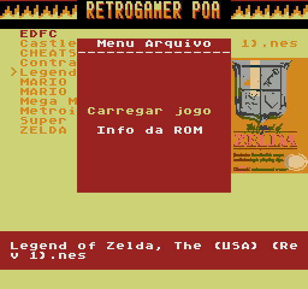

* **Carregar jogo** inicia o jogo; **Info da ROM** mostra mapper, PRG/CHR, bateria e espelhamento (também com a capa).
* **Identificação pelo conteúdo:** o console calcula o CRC-32 dos bytes 512–2559 da ROM e procura `EDFC/ARTS/<CRC>.BIN`. Traduções, revisões e a maioria dos hacks mostram a capa do jogo original.
* **Seguro:** a leitura usa a API de arquivos do próprio OS no laço principal, direto para a CHR-RAM; nada é gravado no cartão e nenhuma memória do OS é alterada.
* **Sem capa?** O menu funciona normalmente, só sem a imagem.

#### Gerar capas para a sua coleção (PC)
```bash
# baixa as capas do libretro-thumbnails + DAT No-Intro e converte para o formato NES
python tools/art_pack.py build                        # -> releases/EDFC-ARTPACK-NES.zip
# identifica cada ROM do cartão (CRC No-Intro, ou nome GoodNES/No-Intro) e grava EDFC/ARTS
python tools/art_pack.py install --sd E:\ --dry-run   # relatório
python tools/art_pack.py install --sd E:\
```
Capas: [libretro-thumbnails](https://github.com/libretro-thumbnails/Nintendo_-_Nintendo_Entertainment_System), direitos dos respectivos detentores.

---

## 🎨 Temas

9 temas com banner próprio, trocados com **SELECT** (capturas do emulador, `python tools/capture_theme_screenshots.py`):

| | | |
| :---: | :---: | :---: |
| 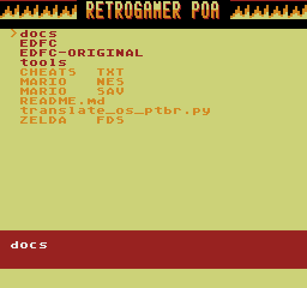<br>**RETROGAMER POA** | 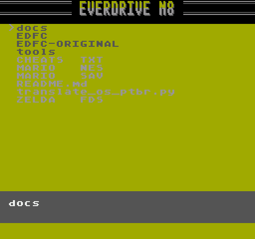<br>**PADRÃO** | 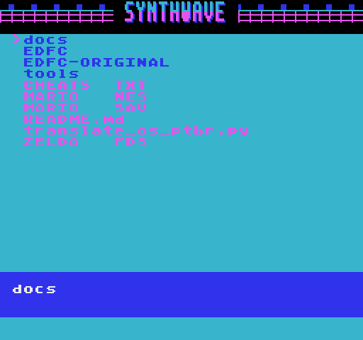<br>**SYNTHWAVE** |
| 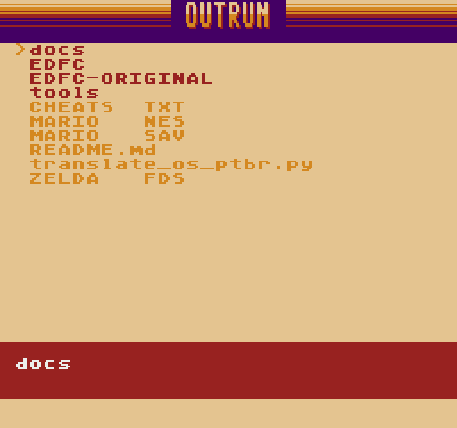<br>**OUTRUN** | 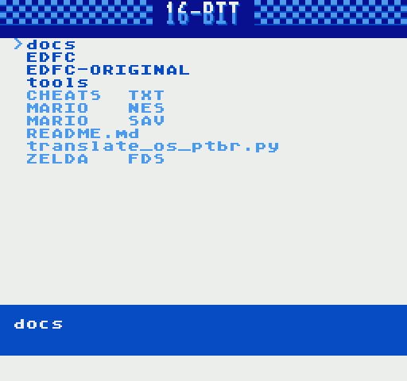<br>**16-BIT** | 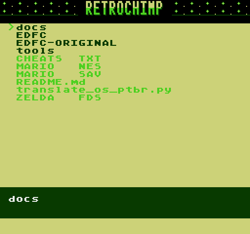<br>**RETROCHIMP** |
| 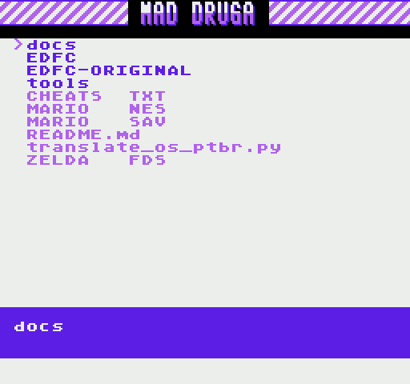<br>**MAD DRUGA** | 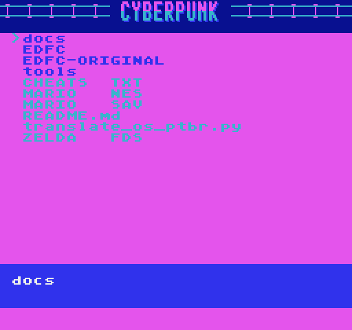<br>**CYBERPUNK** | 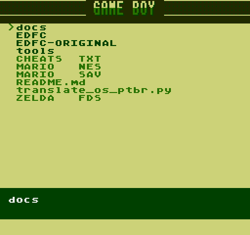<br>**GAME BOY** |

Os banners são gerados por código (`tools/banner_art.py`, prévia em `docs/themes/banners/`). O tema escolhido é salvo na RAM do cartucho (banco 8, `$7FF8`) e restaurado ao reiniciar.

---

## 🌟 Recursos da Tradução

* **Menus e telas traduzidos:** Menu Principal, Opções (balanço de áudio, ordenação, reset para o jogo, inversão A/B, save states), menu do jogo, Info da ROM, Trapaças (Game Genie), Info Sistema, Info Mappers, Sobre e mensagens de erro.
* **Fonte com acentuação completa** (`á ã â é ê í ó õ ô ú ç Á Ã Ç É Í Ó Õ Ú`), em texto comum e destacado.
* **31 núcleos FPGA (.RBF)** e tabela `MAPROUT.BIN` compatíveis com as placas clone (sem tela cinza, sem tiles embaralhados).

---

## 📦 Estrutura no Cartão MicroSD

```text
MicroSD (Raiz)/
└── EDFC/
    ├── OS.BIN              # Sistema Operacional PT-BR (temas, menu do jogo, capas)
    ├── MAPROUT.BIN         # Tabela de roteamento de mappers (512 bytes)
    ├── mappers.png         # Tabela de referência dos mappers suportados
    ├── MAPS/               # 31 núcleos FPGA (.RBF)
    ├── SAVE/               # Saves de bateria (obrigatória)
    └── ARTS/               # Capas dos jogos (opcional)
```

---

## 🛠️ Como Compilar o `OS.BIN`

Requisitos: **Python 3.x** (+ Pillow e NumPy para as capas).

```bash
python translate_os_ptbr.py            # tradução sobre a base original
python tools/install_banner_theme.py   # temas, banners, menu do jogo, capas, botões
python tools/test_theme_safety.py      # testes no emulador do projeto
python tools/test_game_art.py
```

Detalhes técnicos (endereços, hooks, uso de memória) estão nos cabeçalhos de `tools/theme_runtime.py` e `tools/art_runtime.py`.

---

## 📄 Licença e Créditos
* Software original do EverDrive N8 por **Igor Golubovskiy (Krikzz)**.
* Tradução para Português do Brasil e patches de compatibilidade de hardware por **Thiago Carvalho de Mello**.
