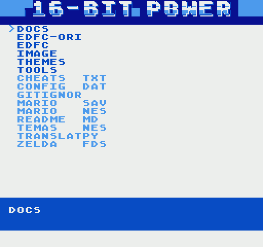

# EverDrive N8 (EDFC) - Tradução Completa em Português do Brasil (PT-BR)

[](https://github.com/thiagocarvalhodemello/nes-everdrive/releases)
[](LICENSE)

Tradução completa para Português do Brasil (PT-BR) do Sistema Operacional do flashcart **EverDrive N8 / Famicom** (por Igor Golubovskiy / Krikzz), com suporte nativo tanto para placas originais quanto para clones de hardware baseados em Altera Cyclone II e MAX II CPLD (revisão `V3.1 2024.07`), agora com **Banners Gráficos por Tema** (banner padrão **RETROGAMER POA**), **Seletor de Temas em Tempo Real** e **Persistência de Configuração na SRAM**!

---

## 🎮 Downloads (Releases)

Na aba [**Releases**](https://github.com/thiagocarvalhodemello/nes-everdrive/releases) (versão atual: **v1.4**):

| Arquivo | O que é |
| :--- | :--- |
| `EDFC-N8-PTBR-v1.4.zip` | **Sistema completo para o cartão** (placas clone `Drive-N8 V3.1 2024.07`, Cyclone II `EP2C5T144C8N` + MAX II `EPM240`): `OS.BIN` PT-BR com temas e capas, 31 núcleos FPGA, `MAPROUT.BIN`, pasta `SAVE`. Extraia na raiz do MicroSD. |
| `EDFC-N8-Capas-v1.4.zip` | **Capas prontas** (2.504 jogos, `EDFC/ARTS/`) identificadas pelo conteúdo da ROM: funcionam com dumps padrão No-Intro/GoodNES, independente do nome do arquivo. Extraia na raiz do MicroSD. |
| `EDFC-N8-ArtPack-Completo.zip` | **Todas as 13.422 capas** do libretro-thumbnails já convertidas, para gerar capas da sua coleção com `tools/art_pack.py install`. |

A versão para **hardware original Krikzz (base v1.26)** continua disponível na [release v1.3](https://github.com/thiagocarvalhodemello/nes-everdrive/releases/tag/v1.3-ptbr).


---

## 🌟 Recursos da Tradução

* **Menus e Telas Traduzidos:**
  * **Menu Principal (`SELECT`):** Opções, Trapaças (Game Genie), Info Sistema, Sobre.
  * **Menu de Opções:** Balanço Áudio, ordenação alfabética, reset para o jogo, inversão dos botões A/B, teclas de Save State.
  * **Menu de Arquivos:** Navegação rápida com suporte a `.NES`, `.FDS`, `.SAV` e `.TXT`.
  * **Visualizador de Informações da ROM:** Mapper, Tamanho PRG/CHR, Memória (RAM/Bateria) e Tipo de Espelhamento (Vertical/Horizontal/4-Screen).
  * **Códigos Game Genie:** Adição, edição e alternância rápida de códigos de trapaça.
  * **Informações do Dispositivo (Info Sistema):** Exibição da versão do OS, versão da BIOS, CPLD, data e hora.
  * **Tela Sobre:** Créditos completos em português.
  * **Mensagens do Sistema e Erros:** Formato inválido, erros de leitura do cartão SD, inicialização e restauração de padrões.

* **Fonte Customizada com Acentuação Completa:**
  * Injetada no **Bank 0 (CHR)** com suporte completo a caracteres acentuados (`á`, `ã`, `â`, `é`, `ê`, `í`, `ó`, `õ`, `ô`, `ú`, `ç`, `Á`, `Ã`, `Ç`, `É`, `Í`, `Ó`, `Õ`, `Ú`), tanto para texto comum quanto destacado/selecionado.

---

## 📦 Estrutura de Arquivos no Cartão MicroSD

Basta descompactar `EDFC-N8-PTBR-v1.4.zip` (e, se quiser, `EDFC-N8-Capas-v1.4.zip`) diretamente na raiz do seu cartão MicroSD (formatado em FAT16 ou FAT32):

```text
MicroSD (Raiz)/
├── TEMAS.NES               # Aplicativo de visualização das paletas de temas
└── EDFC/
    ├── OS.BIN              # Sistema Operacional PT-BR (temas, banners e capas)
    ├── THEMES.NES          # Cópia do aplicativo de temas
    ├── MAPROUT.BIN         # Tabela de roteamento de mappers (512 bytes)
    ├── mappers.png         # Tabela de referência dos mappers suportados
    ├── MAPS/               # 31 núcleos FPGA (.RBF) compatíveis
    ├── SAVE/               # Saves de bateria (obrigatória)
    └── ARTS/               # Capas dos jogos (opcional, EDFC-N8-Capas-*.zip)
```

---

## 🎨 Personalização de Temas e Paletas de Cores

O sistema agora conta com um **Seletor e Personalizador de Temas** (`tools/theme_selector.py`) que permite alterar a paleta de cores de toda a interface do EverDrive N8 (fundo, bordas, texto comum, texto selecionado e caixas de diálogo).

### 🌈 Temas Disponíveis

| Tema | Visualização | Descrição e Paleta |
| :--- | :---: | :--- |
| **Clássico (Padrão)** |  | Fundo preto, texto cinza e destaque amarelo ouro original do EverDrive. |
| **Matrix / Hacker** |  | Estilo terminal CRT com texto verde fosforescente e destaque lima neon. |
| **Cyberpunk 2077** |  | Fundo azul noturno profundo com texto ciano elétrico e destaque magenta. |
| **Game Boy DMG** |  | Tons verdes clássicos da tela LCD do Game Boy clássico (1989). |
| **Âmbar Retrô CRT** |  | Monitores fósforo âmbar quentes dos computadores dos anos 80. |
| **Midnight Dark / OLED**| | Preto absoluto com texto cinza cristalino e destaque azul celeste elétrico. |
| **Crimson Famicom** |  | Fundo escuro com texto vermelho rubi e destaque coral brilhante. |
| **Deep Ocean** |  | Fundo azul marinho profundo, texto azul suave e destaque ciano cristalino. |
| **Synthwave Sunset** |  | Fundo púrpura crepúsculo, texto amarelo suave e destaque laranja pôr do sol. |

---

### 🖼️ Temas do Seletor In-System (`SELECT` + `DIREITA`/`ESQUERDA`)

O `OS.BIN` inclui 9 temas com banner gráfico, alternáveis direto no console. Capturas geradas no emulador a partir do `EDFC/OS.BIN` (`python tools/capture_theme_screenshots.py`):

| | | |
| :---: | :---: | :---: |
| <br>**0 · RETROGAMER POA** | <br>**1 · PADRÃO** | <br>**2 · SYNTHWAVE** |
| <br>**3 · OUTRUN** | <br>**4 · SEGA 16-BIT** | <br>**5 · RETROCHIMP** |
| <br>**6 · MAD DRUGA** | <br>**7 · CYBERPUNK** | <br>**8 · GAME BOY** |

### 🖼️ Capas dos Jogos na Tela "Info da ROM"

Ao abrir **Menu Arquivo → Info da ROM**, o sistema mostra a capa do jogo (64×96 px, 48 sprites 8×16, 4 paletas de 3 cores) ao lado da janela de informações:


* **Identificação pelo conteúdo, não pelo nome:** o console calcula o CRC-32 dos bytes 512–2559 da ROM e procura `EDFC/ARTS/<CRC>.BIN` no cartão (a pasta tem 4 letras porque o OS compara nomes de pasta com exatamente 4 caracteres). Traduções, revisões e a maioria dos hacks compartilham a capa do jogo original.
* **Seguro para o cartão SD:** a leitura usa a API de arquivos do próprio OS, no laço principal, direto para a CHR-RAM (`$1000`, tabela não usada pelo OS). Nada é escrito no cartão nem na RAM de trabalho do OS.
* **Sem capa?** A janela funciona exatamente como antes.

#### Gerar e instalar as capas (PC)
```bash
# 1. Baixa todas as capas do libretro-thumbnails + DAT No-Intro e converte para o formato NES
#    (downloads em paralelo + conversão em todos os núcleos; retoma de onde parou)
python tools/art_pack.py build                       # -> releases/EDFC-ARTPACK-NES.zip

# 2. Identifica cada ROM do cartão pelo CRC (No-Intro) ou pelo nome (GoodNES/No-Intro)
#    e grava EDFC/ARTS/<CRC>.BIN
python tools/art_pack.py install --sd E:\ --dry-run  # relatório
python tools/art_pack.py install --sd E:\            # instala
```
As capas são de terceiros (libretro-thumbnails) e servem apenas para uso pessoal; o pacote não é distribuído neste repositório.

### 🕹️ Como Mudar o Tema

#### Método 1: Troca Dinâmica em Tempo Real no Console (Atalhos de Controle) ⭐ NOVO!
Você pode trocar o tema visual **diretamente no console e em tempo real** enquanto navega pelos seus jogos no EverDrive N8! O sistema possui um seletor nativo residente em memória:

* 🎮 **`SELECT` + `DIREITA`**: Avança para o próximo tema instantaneamente.
* 🎮 **`SELECT` + `ESQUERDA`**: Retorna ao tema anterior.

A paleta de cores (fundo, texto, seleções e caixas de diálogo) e o banner são atualizados na tela da TV assim que o sistema volta a aguardar um botão.

> **Segurança do cartão SD:** a interrupção de vídeo (NMI) apenas registra o atalho; a troca de tema é aplicada pelo laço principal do menu, quando não há leitura/gravação no cartão em andamento. Versões anteriores aplicavam o tema dentro da NMI, alterando o registrador de banco do mapper (`$4400/$4401`) e gravando no heap do sistema (`$7BA6`, `$7C00`), o que podia corromper o sistema de arquivos do cartão SD.

##### 💾 Como Funciona a Persistência (Salvar ao Reiniciar)
* **Memória SRAM do Cartucho (Resets e Bateria):** Ao alternar de tema, a configuração é salva na RAM do cartucho (banco 8, `$7FF8..$7FFB`, fora da área usada pelo heap do sistema). Ao apertar o botão Reset do console ou ligar novamente, a rotina de boot restaura o último tema selecionado automaticamente!
* **Arquivo Container `CONFIG.DAT` (MicroSD):** Disponibilizamos o arquivo container `EDFC/CONFIG.DAT` (e na raiz) como scratchpad de 512 bytes para garantir a persistência de configuração de temas em cartuchos com bateria descarregada ou ausente.

---

#### Método 2: Executar o Aplicativo de Demonstração (`TEMAS.NES`)
Incluímos na raiz e na pasta `EDFC/` a ROM interativa **`TEMAS.NES`** (Mapper 0 / NROM):
1. No menu do EverDrive, selecione e execute **`TEMAS.NES`** (ou `EDFC/THEMES.NES`).
2. Use o direcional para testar as 9 paletas em tempo real na tela da sua TV e conferir a tabela completa de cores antes de jogar.

---

#### Método 3: Fixar um Tema Padrão Permanente
Todas as pastas prontas estão disponíveis na pasta `THEMES/`:
1. Escolha a pasta do tema que preferir (ex: `THEMES/MATRIX/` ou `THEMES/CYBERPUNK/`).
2. Copie o arquivo `OS.BIN` dessa pasta para a pasta `EDFC/` do seu cartão MicroSD. Esse tema passará a ser a cor padrão na inicialização do sistema.

---

#### Método 4: Usar o Script Seletor Interativo (PC)
Execute o utilitário no terminal:
```bash
python tools/theme_selector.py
```
Um menu interativo será exibido para você escolher o tema, aplicar diretamente no seu `OS.BIN` ou gerar pré-visualizações.

#### Método 3: Linha de Comando Direta
```bash
# Aplicar tema Matrix
python tools/theme_selector.py --theme matrix

# Aplicar tema Cyberpunk
python tools/theme_selector.py --theme cyberpunk

# Criar uma paleta personalizada informando os códigos hexadecimais da paleta NES
python tools/theme_selector.py --custom 0F,2A,0F,39,0F,0F,0F,0F,0F,0F,0F,0F,0F,30,09,39
```

---

## 🛠️ Como Compilar ou Modificar o `OS.BIN`

Requisitos: **Python 3.x**

Para recriar ou alterar os textos da tradução:
```bash
python translate_os_ptbr.py
```
O script processa a base do OS, injeta os glifos acentuados na fonte CHR, atualiza as tabelas de ponteiros no PRG-ROM e aplica os patches de compatibilidade e centralização, gerando `EDFC/OS.BIN` e a ROM `EDFC/OS_PTBR_TEST.nes`.

---

## 📄 Licença e Créditos
* Software original do EverDrive N8 por **Igor Golubovskiy (Krikzz)**.
* Tradução para Português do Brasil e patches de compatibilidade de hardware por **Thiago Carvalho de Mello**.
