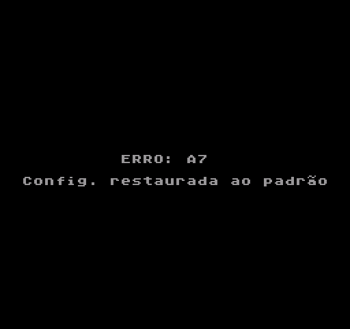
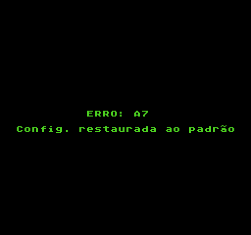
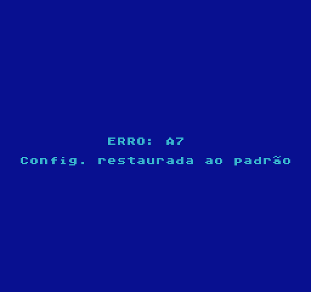
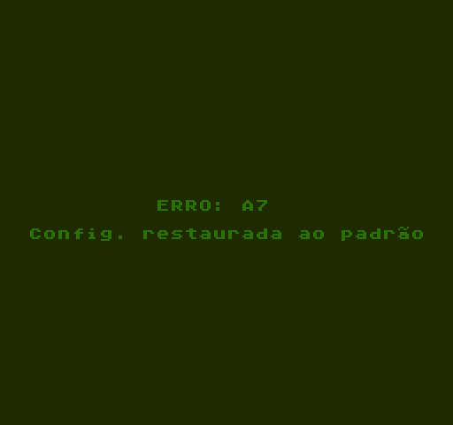
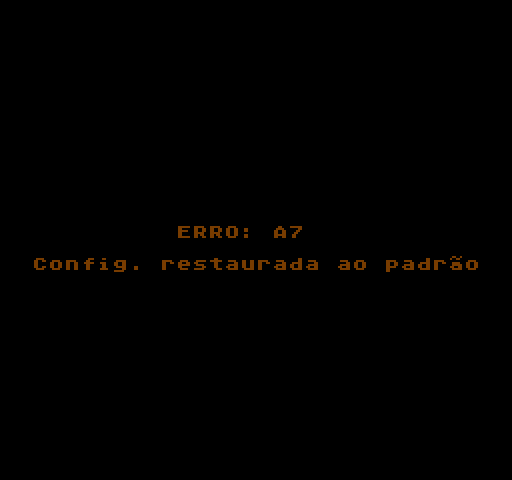
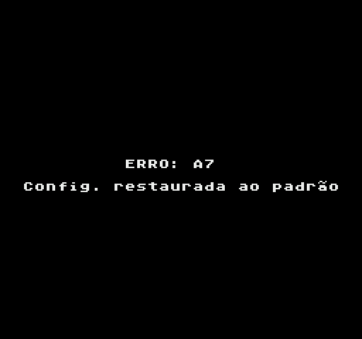
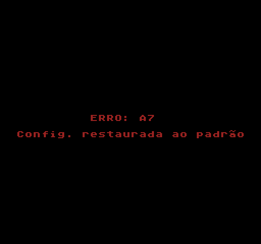
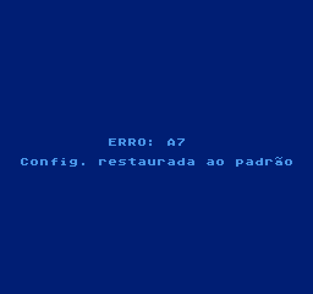
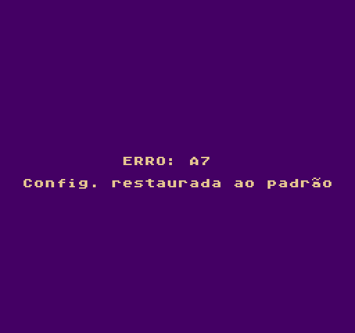

# EverDrive N8 (EDFC) - Tradução Completa em Português do Brasil (PT-BR)

[](https://github.com/thiagocarvalhodemello/nes-everdrive/releases)
[](LICENSE)

Tradução completa para Português do Brasil (PT-BR) do Sistema Operacional do flashcart **EverDrive N8 / Famicom** (por Igor Golubovskiy / Krikzz), com suporte nativo tanto para placas originais quanto para clones de hardware baseados em Altera Cyclone II e MAX II CPLD (revisão `V3.1 2024.07`), agora com **Banners Gráficos por Tema** (banner padrão **RETROGAMER POA**), **Seletor de Temas em Tempo Real** e **Persistência de Configuração na SRAM**!

---

## 🎮 Versões Disponíveis nas Releases

Disponibilizamos versões pré-empacotadas prontas para uso direto no cartão MicroSD na aba [**Releases**](https://github.com/thiagocarvalhodemello/nes-everdrive/releases):

### 1. [Versão Clone Hardware (Recomendada para Placas V3.1 e Cyclone II)](https://github.com/thiagocarvalhodemello/nes-everdrive/releases)
* **Arquivo:** `EDFC-PTBR-v1.16-CloneHardware.zip`
* **Compatibilidade:** Cartuchos EverDrive N8 clone (ex: AliExpress `Drive-N8 V3.1 2024.07` com Cyclone II `EP2C5T144C8N` e CPLD MAX II `EPM240`).
* **Características:**
  * **Banners Gráficos de Topo:** Header visual temático nas duas primeiras linhas (256x16 pixels) com o banner oficial **RETROGAMER POA** como padrão.
  * **Seletor de Temas Integrado ao Vivo:** Alterne temas a qualquer momento com as teclas de atalho **`SELECT` + `DIREITA`** e **`SELECT` + `ESQUERDA`**.
  * **Persistência na SRAM:** O tema selecionado é memorizado na memória estática do cartucho e restaurado automaticamente ao reiniciar.
  * 100% livre de tela cinza ao iniciar jogos (núcleos FPGA `.RBF` originais restaurados).
  * Barramento de CHR-RAM 100% sincronizado (sem linhas azuis ou pixels/tiles embaralhados).
  * Tradução integral de todos os menus, opções, Game Genie e mensagens de sistema.
  * Conjunto completo de **31 núcleos FPGA (.RBF)** e tabela `MAPROUT.BIN` (512 bytes).
  * 100% de compatibilidade testada com mais de 3.500 jogos da biblioteca de NES/Famicom.

### 2. [Pacote de Variantes de Temas e Banners](https://github.com/thiagocarvalhodemello/nes-everdrive/releases)
* **Arquivo:** `EDFC-THEMES-AllVariants.zip`
* **Conteúdo:** Todos os 9 temas visuais completos prontos para uso com seus respectivos banners gráficos:
  1. **RETROGAMER POA** (Tema padrão com logo em chamas)
  2. **PADRÃO** (Visual clássico EverDrive azul e branco)
  3. **SYNTHWAVE** (Grade retrô neon magenta e ciano)
  4. **OUTRUN** (Pôr do sol retrô anos 80 gradiente)
  5. **SEGA 16-BIT** (Estilo arcade 16-bit)
  6. **RETROCHIMP** (Logo estilizado retrô)
  7. **MAD DRUGA** (Tema gamer verde e preto)
  8. **CYBERPUNK** (Visual futurista neon)
  9. **GAME BOY DMG** (Monocromático clássico verde)

### 3. [Versão Hardware Original (Base Oficial v1.26)](https://github.com/thiagocarvalhodemello/nes-everdrive/releases)
* **Arquivo:** `EDFC-PTBR-v1.26-OriginalHardware.zip`
* **Compatibilidade:** EverDrive N8 original da Krikzz.
* **Características:**
  * Base oficial mais recente **v1.26** com tradução integral em PT-BR.
  * Menu de Balanço de Áudio de expansão (FDS, VRC6, VRC7, Namco-163, MMC5, Sunsoft-5B).
  * Suporte a Save States e teclas de atalho.
  * Patches de centralização de texto e versão customizada.

### 4. [ROM de Teste Standalone para Emuladores](https://github.com/thiagocarvalhodemello/nes-everdrive/releases)
* **Arquivo:** `EDFC-PTBR-Standalone-TestROM.zip`
* **Compatibilidade:** Mesen, FCEUX, RetroArch, Nestopia e qualquer emulador de NES (Mapper 0).
* Permite navegar pelo sistema e testar a interface traduzida diretamente no computador.

---

## 🌟 Recursos da Tradução

* **Menus e Telas Traduzidos:**
  * **Menu Principal (`SELECT`):** Opções, Trapaças (Game Genie), Info Sistema, Sobre.
  * **Menu de Opções:** Balanço Áudio, ordenação alfabética, reset para o jogo, inversão dos botões A/B, teclas de Save State.
  * **Menu de Arquivos:** Navegação rápida com suporte a `.NES`, `.FDS`, `.SAV` e `.TXT`.
  * **Visualizador de Informações da ROM:** Mapper, Tamanho PRG/CHR, Memória (RAM/Bateria) e Tipo de Espelhamento (Vertical/Horizontal/4-Screen).
  * **Códigos Game Genie:** Adição, edição e alternância rápida de códigos de trapaça.
  * **Informações do Dispositivo (Info Sistema):** Exibição da versão do OS, versão da BIOS, CPLD, data e hora.
  * **Tela Sobre:** Créditos completos em português.
  * **Mensagens do Sistema e Erros:** Formato inválido, erros de leitura do cartão SD, inicialização e restauração de padrões.

* **Fonte Customizada com Acentuação Completa:**
  * Injetada no **Bank 0 (CHR)** com suporte completo a caracteres acentuados (`á`, `ã`, `â`, `é`, `ê`, `í`, `ó`, `õ`, `ô`, `ú`, `ç`, `Á`, `Ã`, `Ç`, `É`, `Í`, `Ó`, `Õ`, `Ú`), tanto para texto comum quanto destacado/selecionado.

---

## 📦 Estrutura de Arquivos no Cartão MicroSD

Basta descompactar o arquivo `.zip` da release desejada diretamente na raiz do seu cartão MicroSD (formatado em FAT16 ou FAT32):

```text
MicroSD (Raiz)/
├── TEMAS.NES               # Aplicativo interativo de teste e visualização de temas
├── CONFIG.DAT              # Arquivo de configuração container / scratchpad
└── EDFC/
    ├── OS.BIN              # Sistema Operacional PT-BR com seletor de temas integrado
    ├── CONFIG.DAT          # Configuração persistente do tema ativo
    ├── THEMES.NES          # Aplicativo interativo de temas (cópia dentro da pasta EDFC)
    ├── MAPROUT.BIN         # Tabela de roteamento de mappers (512 bytes)
    ├── mappers.png         # Tabela de referência dos mappers suportados
    ├── MAPS/               # 31 núcleos FPGA (.RBF) compatíveis
    └── SAVE/               # Diretório para armazenamento dos saves de bateria
```

---

## 🎨 Personalização de Temas e Paletas de Cores

O sistema agora conta com um **Seletor e Personalizador de Temas** (`tools/theme_selector.py`) que permite alterar a paleta de cores de toda a interface do EverDrive N8 (fundo, bordas, texto comum, texto selecionado e caixas de diálogo).

### 🌈 Temas Disponíveis

| Tema | Visualização | Descrição e Paleta |
| :--- | :---: | :--- |
| **Clássico (Padrão)** |  | Fundo preto, texto cinza e destaque amarelo ouro original do EverDrive. |
| **Matrix / Hacker** |  | Estilo terminal CRT com texto verde fosforescente e destaque lima neon. |
| **Cyberpunk 2077** |  | Fundo azul noturno profundo com texto ciano elétrico e destaque magenta. |
| **Game Boy DMG** |  | Tons verdes clássicos da tela LCD do Game Boy clássico (1989). |
| **Âmbar Retrô CRT** |  | Monitores fósforo âmbar quentes dos computadores dos anos 80. |
| **Midnight Dark / OLED**| | Preto absoluto com texto cinza cristalino e destaque azul celeste elétrico. |
| **Crimson Famicom** |  | Fundo escuro com texto vermelho rubi e destaque coral brilhante. |
| **Deep Ocean** |  | Fundo azul marinho profundo, texto azul suave e destaque ciano cristalino. |
| **Synthwave Sunset** |  | Fundo púrpura crepúsculo, texto amarelo suave e destaque laranja pôr do sol. |

---

### 🕹️ Como Mudar o Tema

#### Método 1: Troca Dinâmica em Tempo Real no Console (Atalhos de Controle) ⭐ NOVO!
Você pode trocar o tema visual **diretamente no console e em tempo real** enquanto navega pelos seus jogos no EverDrive N8! O sistema possui um seletor nativo residente em memória:

* 🎮 **`SELECT` + `DIREITA`**: Avança para o próximo tema instantaneamente.
* 🎮 **`SELECT` + `ESQUERDA`**: Retorna ao tema anterior.

A paleta de cores (fundo, texto, seleções e caixas de diálogo) atualiza instantaneamente na tela da TV sem qualquer travamento ou corrupção de tiles!

##### 💾 Como Funciona a Persistência (Salvar ao Reiniciar)
* **Memória SRAM do Cartucho (Resets e Bateria):** Ao alternar de tema, a configuração é salva instantaneamente na SRAM protegida por bateria (`$7BA6..$7BA9`). Ao apertar o botão Reset do console ou ligar novamente, a rotina de boot restaura o último tema selecionado automaticamente!
* **Arquivo Container `CONFIG.DAT` (MicroSD):** Disponibilizamos o arquivo container `EDFC/CONFIG.DAT` (e na raiz) como scratchpad de 512 bytes para garantir a persistência de configuração de temas em cartuchos com bateria descarregada ou ausente.

---

#### Método 2: Executar o Aplicativo de Demonstração (`TEMAS.NES`)
Incluímos na raiz e na pasta `EDFC/` a ROM interativa **`TEMAS.NES`** (Mapper 0 / NROM):
1. No menu do EverDrive, selecione e execute **`TEMAS.NES`** (ou `EDFC/THEMES.NES`).
2. Use o direcional para testar as 9 paletas em tempo real na tela da sua TV e conferir a tabela completa de cores antes de jogar.

---

#### Método 3: Fixar um Tema Padrão Permanente
Todas as pastas prontas estão disponíveis na pasta `THEMES/`:
1. Escolha a pasta do tema que preferir (ex: `THEMES/MATRIX/` ou `THEMES/CYBERPUNK/`).
2. Copie o arquivo `OS.BIN` dessa pasta para a pasta `EDFC/` do seu cartão MicroSD. Esse tema passará a ser a cor padrão na inicialização do sistema.

---

#### Método 4: Usar o Script Seletor Interativo (PC)
Execute o utilitário no terminal:
```bash
python tools/theme_selector.py
```
Um menu interativo será exibido para você escolher o tema, aplicar diretamente no seu `OS.BIN` ou gerar pré-visualizações.

#### Método 3: Linha de Comando Direta
```bash
# Aplicar tema Matrix
python tools/theme_selector.py --theme matrix

# Aplicar tema Cyberpunk
python tools/theme_selector.py --theme cyberpunk

# Criar uma paleta personalizada informando os códigos hexadecimais da paleta NES
python tools/theme_selector.py --custom 0F,2A,0F,39,0F,0F,0F,0F,0F,0F,0F,0F,0F,30,09,39
```

---

## 🛠️ Como Compilar ou Modificar o `OS.BIN`

Requisitos: **Python 3.x**

Para recriar ou alterar os textos da tradução:
```bash
python translate_os_ptbr.py
```
O script processa a base do OS, injeta os glifos acentuados na fonte CHR, atualiza as tabelas de ponteiros no PRG-ROM e aplica os patches de compatibilidade e centralização, gerando `EDFC/OS.BIN` e a ROM `EDFC/OS_PTBR_TEST.nes`.

---

## 📄 Licença e Créditos
* Software original do EverDrive N8 por **Igor Golubovskiy (Krikzz)**.
* Tradução para Português do Brasil e patches de compatibilidade de hardware por **Thiago Carvalho de Mello**.
