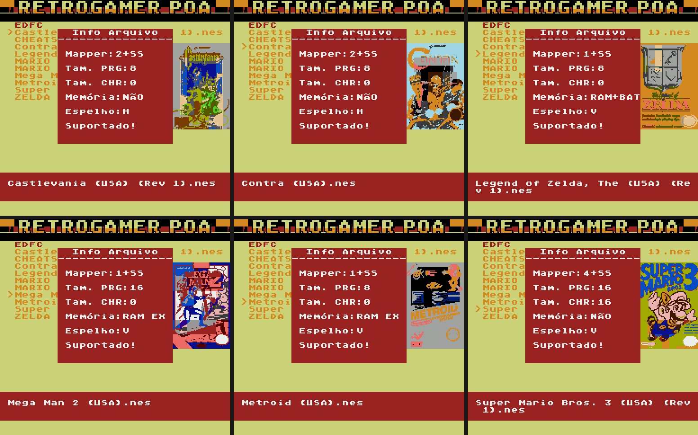
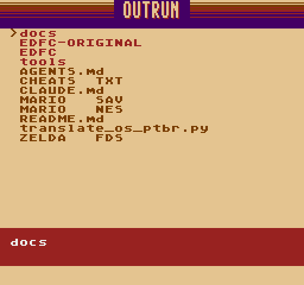

## EverDrive N8 PT-BR v1.4: capas dos jogos + correção de corrupção do cartão SD

### ⚠️ Correção importante: corrupção do cartão SD ao trocar de tema
Na v1.3, trocar de tema (`SELECT` + `DIREITA`/`ESQUERDA`) podia corromper o sistema de arquivos do cartão e exigir formatação. A troca era feita dentro da interrupção de vídeo (NMI) e:
* alterava o registrador de banco do mapper (`$4400/$4401`) no meio de leituras/gravações do OS no cartão;
* gravava dados do tema dentro do heap do OS (`$7BA6`, `$7C00`), onde o OS guarda buffers de setor.

Agora a NMI só registra o atalho; o tema é aplicado no laço principal do menu, quando não há acesso ao cartão em andamento, e o tema salvo fica fora do heap (`$7FF8`). **Se o seu cartão foi corrompido pela v1.3, formate-o uma vez e use a v1.4.**

### 🖼️ Novo: capas dos jogos em "Info da ROM"
* Em **Menu Arquivo → Info da ROM**, a capa do jogo (64×96 px, 48 sprites, 12 cores) aparece ao lado da janela.
* A ROM é identificada pelo **conteúdo** (CRC-32 de 2 KB do código), não pelo nome: arquivos renomeados, headers "sujos", traduções e revisões mostram a capa do jogo original.
* Leitura só pelo próprio OS, direto para a CHR-RAM: nada é gravado no cartão. Sem capa, a janela funciona como antes.

### 🎨 Temas
9 temas com banner: RETROGAMER POA, PADRÃO, SYNTHWAVE, OUTRUN, SEGA 16-BIT, RETROCHIMP, MAD DRUGA, CYBERPUNK, GAME BOY.

---

### 📦 Arquivos
| Arquivo | Uso |
| :--- | :--- |
| **`EDFC-N8-PTBR-v1.4.zip`** | Sistema completo (placas clone V3.1 / Cyclone II). Extraia na **raiz** do MicroSD. |
| **`EDFC-N8-Capas-v1.4.zip`** | 2.504 capas prontas (`EDFC/ARTS/`) para dumps padrão No-Intro/GoodNES. Extraia na **raiz** do MicroSD. |
| `EDFC-N8-ArtPack-Completo.zip` | Todas as 13.422 capas convertidas, para gerar capas da sua própria coleção: `python tools/art_pack.py install --pack EDFC-N8-ArtPack-Completo.zip --sd E:\` |

Hardware original Krikzz (base v1.26): use a [release v1.3](https://github.com/thiagocarvalhodemello/nes-everdrive/releases/tag/v1.3-ptbr).

### ℹ️ Observações
* Testado no emulador do projeto (`tools/test_theme_safety.py`, `tools/test_game_art.py`); relatos de teste no hardware real são bem-vindos.
* Ao abrir "Info da ROM" a tela pisca por ~0,3 s enquanto a capa é carregada.
* Capas: [libretro-thumbnails](https://github.com/libretro-thumbnails/Nintendo_-_Nintendo_Entertainment_System); direitos dos respectivos detentores.
