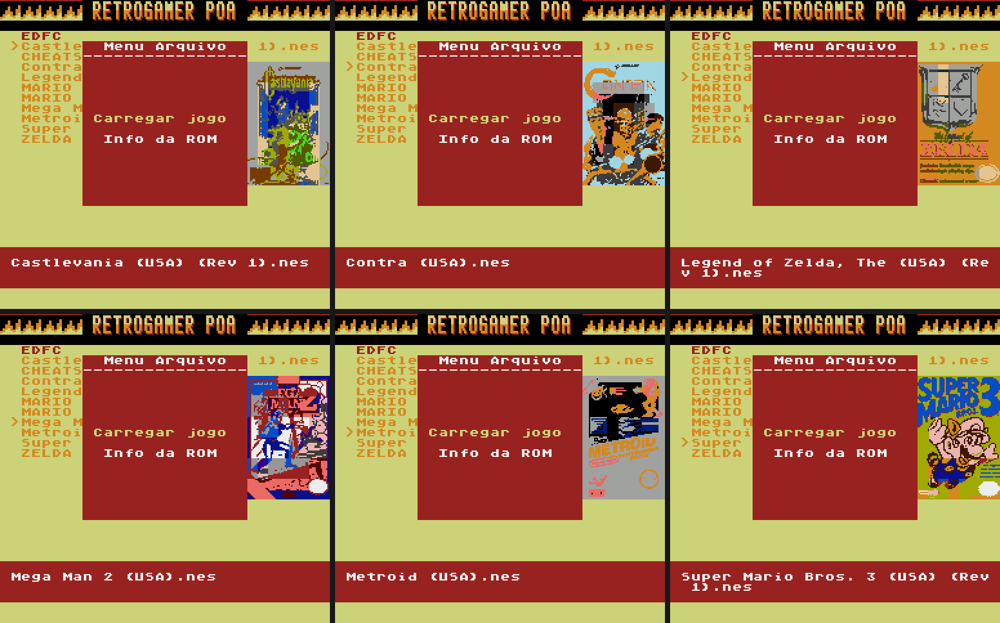
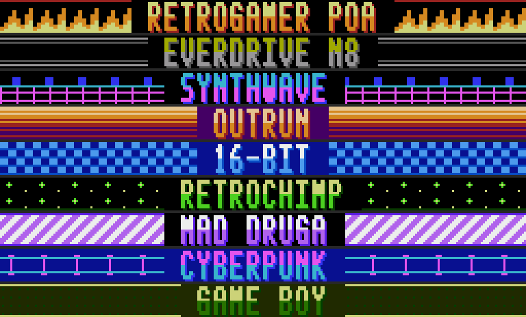

## EverDrive N8 PT-BR v1.5: menu do jogo, novos botões, novos banners

### 📦 Qual baixar
Escolha **um** e extraia na **raiz** do cartão MicroSD:
* **`EDFC-N8-PTBR-v1.5-com-capas.zip`**: sistema + 2.504 capas
* **`EDFC-N8-PTBR-v1.5.zip`**: sistema sem capas

### 🕹️ Novos controles no navegador
| Botão | Ação |
| :--- | :--- |
| **A / B** (confirmar) | **Menu do jogo**: capa + `Carregar jogo` + `Info da ROM` |
| **SELECT** | Próximo tema (em ciclo, fica salvo) |
| **START** | Menu Principal |

### 🐞 Correções
* **Lista de jogos corrompida até reiniciar (v1.4):** ao mostrar uma capa, a v1.4 usava a página `$0300` da RAM, que guarda dados do próprio OS (tabelas e variáveis da listagem). Agora as capas usam só áreas livres (`$0100`, `$0200`) e os dados do OS ficam intactos (verificado em teste).
* A troca de tema acontece no próprio navegador, com redesenho completo da tela; a interrupção de vídeo voltou a ser a original do OS.

### 🎨 Banners novos
9 banners refeitos do zero para o N8, sem nada do EverDrive MD (o tema "PADRÃO" agora diz **EVERDRIVE N8**, e "SEGA 16-BIT" virou **16-BIT**):

### 🧹 Limpeza
Release com só 2 arquivos; removidos do pacote e do repositório os arquivos obsoletos (`TEMAS.NES`, `THEMES.NES`, `CONFIG.DAT`, variantes de paleta `THEMES/`, imagens e scripts antigos).

### ℹ️ Observações
* Testado no emulador do projeto (`tools/test_theme_safety.py`, `tools/test_game_art.py`); relatos no hardware real são bem-vindos.
* Ao abrir o menu do jogo a tela pisca por ~0,3 s enquanto a capa carrega.
* Capas: [libretro-thumbnails](https://github.com/libretro-thumbnails/Nintendo_-_Nintendo_Entertainment_System); direitos dos respectivos detentores. Hardware original Krikzz (base v1.26): [release v1.3](https://github.com/thiagocarvalhodemello/nes-everdrive/releases/tag/v1.3-ptbr).
