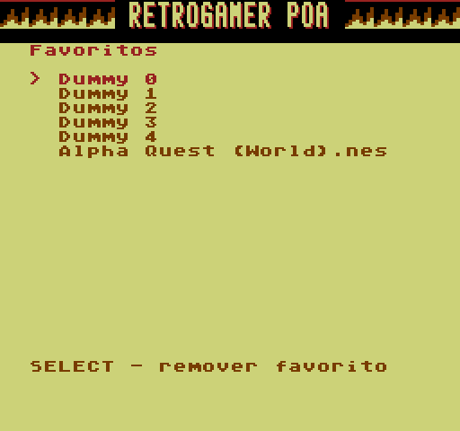
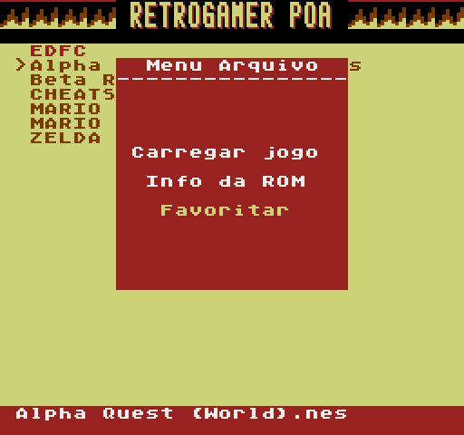
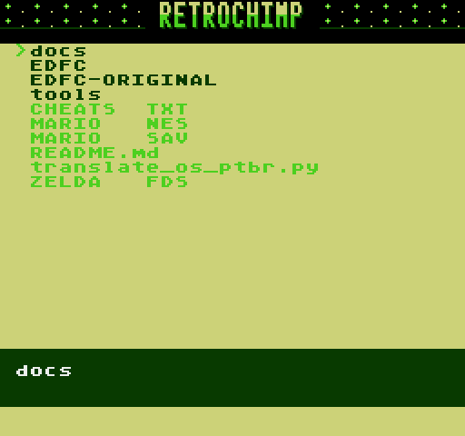
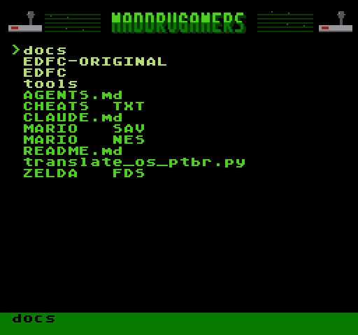

## EverDrive N8 PT-BR v1.6: favoritos, MADDRUGAMERS e RETROCHIMP refeitos, lista legível em todos os temas

### 📦 Qual baixar
Escolha **um** e extraia na **raiz** do cartão MicroSD:
* **`EDFC-N8-PTBR-v1.6-com-capas.zip`**: sistema + 2.504 capas
* **`EDFC-N8-PTBR-v1.6.zip`**: sistema sem capas

> **Atualizando de uma versão anterior?** Pode extrair por cima normalmente. Numa próxima atualização, se já tiver favoritos, **não substitua o `EDFC/FAVS.DAT`** do cartão, senão a lista volta a ficar vazia.

### ⭐ Favoritos
| | |
| :---: | :---: |
|  |  |

* **Adicionar:** o menu do jogo (confirmar sobre uma ROM) agora tem **Carregar jogo / Info da ROM / Favoritar**.
* **Abrir:** **START → Favoritos**, o novo item do Menu Principal.
* Até **32 jogos**, mostrados pelo nome e na ordem em que foram adicionados. Na lista: **cima/baixo** escolhe, **confirmar** inicia o jogo, **SELECT** remove e **cancelar** volta.
* Os favoritos ficam em `EDFC/FAVS.DAT` (16 KB, já vem no zip). O console nunca cria arquivos nem mexe na FAT: só regrava setores dentro desse arquivo e confere uma assinatura antes de cada gravação.

### 🎨 Temas
* **MADDRUGAMERS** (no estilo do canal [@maddrugamers](https://www.youtube.com/@maddrugamers), com joysticks nos cantos) e **RETROCHIMP** (com o chimpanzé nos cantos) foram refeitos no estilo dos outros projetos.
* Cada tema agora tem uma paleta própria de 16 cores.

| | |
| :---: | :---: |
|  |  |

### 🐞 Correções
* **Lista de jogos "corrompida" em alguns temas (v1.5):** era falta de contraste na paleta. A cor do texto dos arquivos ficava quase igual ao fundo da lista, então parecia lixo na tela. O build agora recusa combinações ilegíveis, e todos os temas foram conferidos numa pasta com arquivos.

### ℹ️ Outros
* Tela **Sobre** com crédito do mod (*thenobre e Antonio Scartezzini, do grupo RETROGAMER POA*) e os controles atuais.

### ℹ️ Observações
* Testado no emulador do projeto (`tools/test_theme_safety.py`, `tools/test_game_art.py`, `tools/test_favorites.py`). O emulador não reproduz o tempo real do vídeo, então relatos no hardware são bem-vindos, principalmente sobre os favoritos.
* Base: OS de fábrica da placa clone Drive-N8 V3.1 2024.07 ("OS ver 13"). Para o hardware original Krikzz (base v1.26), use a [release v1.3](https://github.com/thiagocarvalhodemello/nes-everdrive/releases/tag/v1.3-ptbr).
* Capas: [libretro-thumbnails](https://github.com/libretro-thumbnails/Nintendo_-_Nintendo_Entertainment_System); direitos dos respectivos detentores.
