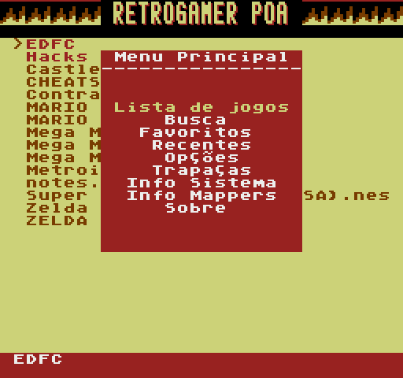
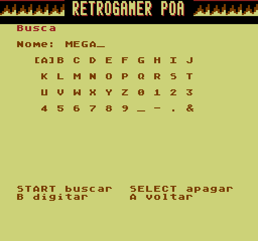
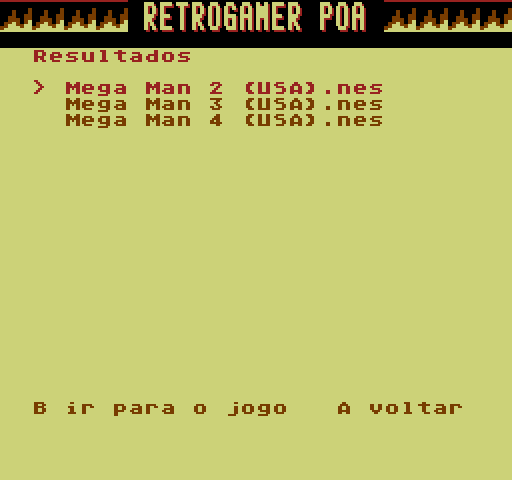
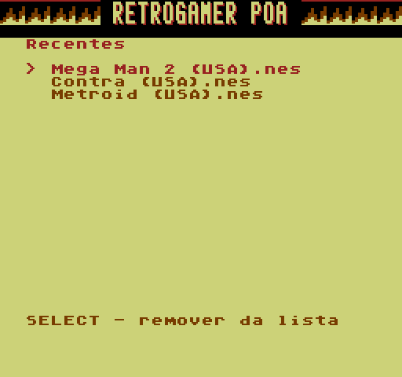

## EverDrive N8 PT-BR v1.7: Menu Principal ao ligar, busca, jogos recentes, ESQ/DIR no menu do jogo

### 📦 Qual baixar
Escolha **um** e extraia na **raiz** do cartão MicroSD:
* **`EDFC-N8-PTBR-v1.7-com-capas.zip`**: sistema + 2.504 capas
* **`EDFC-N8-PTBR-v1.7.zip`**: sistema sem capas

> **Atualizando?** Pode extrair por cima, mas **não substitua o `EDFC/FAVS.DAT`** do cartão se já tiver favoritos.
> O `EDFC/RECENTS.DAT` é novo e precisa ir para o cartão. Os arquivos **`EDFC/OVL*.BIN` também são novos e
> obrigatórios**: são partes do sistema e devem ser sempre copiados junto com o `OS.BIN`.

### 📋 Menu Principal ao ligar
* O console liga direto no **Menu Principal**, e **START** no navegador abre o menu de novo.
* Itens: **Lista de jogos** (fecha o menu e mostra a pasta), **Busca**, **Favoritos**, **Recentes**, Opções,
  Trapaças, Info Sistema, Info Mappers e Sobre.

### 🔍 Busca
| | |
| :---: | :---: |
|  |  |

* Teclado na tela: o **direcional** escolhe, **confirmar** digita, **SELECT** apaga, **START** busca e **cancelar** volta.
* Procura o trecho digitado em **qualquer parte do nome**, sem diferenciar maiúsculas, na **pasta aberta** no navegador
  (até 32 resultados). Ao escolher um resultado, o navegador para em cima do jogo.

### 🕘 Recentes

* Os últimos **32 jogos** iniciados, do mais recente para o mais antigo. Conta o "Carregar jogo", os favoritos e
  a própria lista.
* **Confirmar** inicia e **SELECT** tira da lista.
* Ficam no `EDFC/RECENTS.DAT`. Cada início de jogo regrava **um** setor desse arquivo, com a mesma conferência de
  assinatura dos favoritos. O console continua sem criar arquivos e sem mexer na FAT.

### 🎮 Menu do jogo
* **ESQ/DIR** troca para o jogo anterior/próximo da pasta sem fechar o menu. Pula pastas e arquivos que não são
  `.nes`/`.fds` e dá a volta no fim da lista. A capa, o nome e o cursor acompanham, e **Carregar jogo**,
  **Info da ROM** e **Favoritar** usam o jogo trocado.

### 🎨 Tela
* **Rodapé** com o nome do arquivo agora fica no **fim da tela** e tem **2 linhas de altura** (antes eram 4).
* Tema **PADRÃO** refeito em fundo azul-marinho, com texto branco e pastas amarelas. O cinza sobre branco ficava
  ilegível na TV.

### ⚙️ Por dentro
* O código novo não cabia no OS, então capas, favoritos, recentes e busca agora são **módulos carregados do cartão**
  (`EDFC/OVL*.BIN`) para o banco de RAM do próprio mod. Nenhuma memória do OS é usada para isso.
* Sem um módulo, o resto funciona: o menu do jogo aparece sem capa, e as listas e a busca mostram
  "Falta EDFC/OVL*.BIN".

### ℹ️ Observações
* Testado no emulador do projeto (`tools/test_theme_safety.py`, `test_game_art.py`, `test_favorites.py`,
  `test_search.py`). O emulador **não reproduz o tempo real do vídeo nem a velocidade do cartão**, então relatos no
  hardware são bem-vindos, principalmente sobre o Menu Principal ao ligar, a busca em pastas grandes e os recentes.
* Ao abrir a busca ou uma lista pela primeira vez, a tela pisca rapidamente enquanto o módulo é lido do cartão.
* Base: OS de fábrica da placa clone Drive-N8 V3.1 2024.07 ("OS ver 13"). Para o hardware original Krikzz (base
  v1.26), use a [release v1.3](https://github.com/thiagocarvalhodemello/nes-everdrive/releases/tag/v1.3-ptbr).
* Capas: [libretro-thumbnails](https://github.com/libretro-thumbnails/Nintendo_-_Nintendo_Entertainment_System); direitos dos respectivos detentores.
