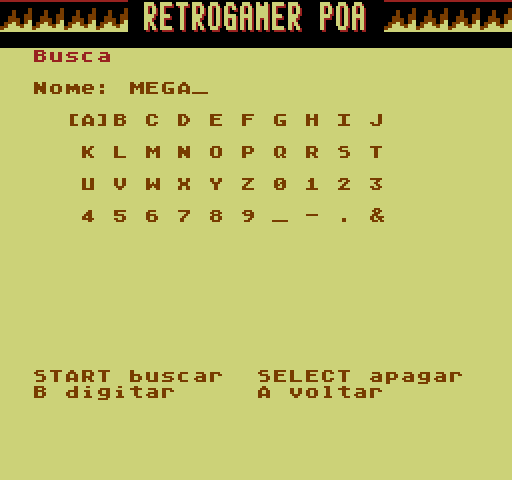
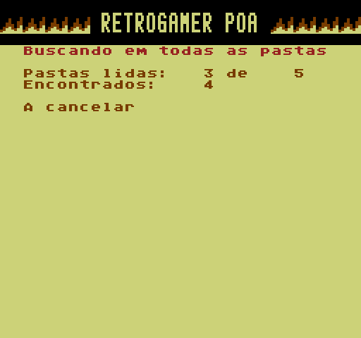
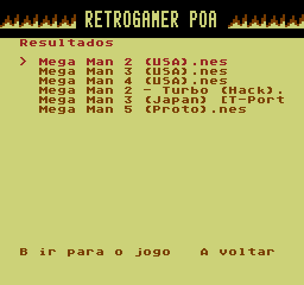

## EverDrive N8 PT-BR v1.8: busca em todas as pastas com progresso, banner inteiro na TV

| | | |
| :---: | :---: | :---: |
|  |  |  |

### 📦 Qual baixar
Escolha **um** e extraia na **raiz** do cartão MicroSD:
* **`EDFC-N8-PTBR-v1.8-com-capas.zip`**: sistema + 2.504 capas
* **`EDFC-N8-PTBR-v1.8.zip`**: sistema sem capas

> **Atualizando?** Pode extrair por cima, mas **não substitua `EDFC/FAVS.DAT` nem `EDFC/RECENTS.DAT`** se quiser
> manter as listas. O **`EDFC/OVLSCAN.BIN` é novo**: todos os `EDFC/OVL*.BIN` devem ir sempre junto com o `OS.BIN`.

### 🔍 Busca em todas as pastas
* Procura em **todas as pastas do cartão** (até 10 níveis; a pasta `EDFC` fica de fora), só jogos `.nes`/`.fds`,
  até 31 resultados.
* **Tela de progresso**: "Pastas lidas: X de Y" e quantos jogos já encontrou. **Cancelar** interrompe e mostra
  o que já achou.
* Ao escolher um resultado, o navegador **abre a pasta do jogo** com ele selecionado; **cancelar** sobe as pastas
  normalmente.
* As subpastas são lidas direto do cartão (bem mais rápido que a rotina de nomes do OS). Só lê o cartão.

### 📺 Tela
* Tudo desceu **uma linha**: o banner não fica mais cortado no topo da TV. A lista continua com 21 jogos por
  página e o rodapé segue no fim da tela.

### 🛠️ Correções
* **Menu Principal ao ligar** agora abre sempre. Antes dependia de tempo e, quando o console recriava as
  configurações (aviso **A7**), o aviso era fechado sozinho.
* **Telas de erro do OS** (como o aviso A7) mostravam uma linha de lixo acima do código; agora mostram só o código.

### ℹ️ Observações
* Testado no emulador do projeto (inclusive o modo com tempo de vídeo, sem escritas fora do vblank). O emulador
  **não reproduz a velocidade real do cartão**: relatos de quanto a busca demora num cartão grande são bem-vindos.
* Ao entrar na busca e ao trocar entre teclado, varredura e resultados a tela pisca rapidamente (módulo sendo lido).
* Base: OS de fábrica da placa clone Drive-N8 V3.1 2024.07 ("OS ver 13"). Para o hardware original Krikzz (base
  v1.26), use a [release v1.3](https://github.com/thiagocarvalhodemello/nes-everdrive/releases/tag/v1.3-ptbr).
* Capas: [libretro-thumbnails](https://github.com/libretro-thumbnails/Nintendo_-_Nintendo_Entertainment_System); direitos dos respectivos detentores.
